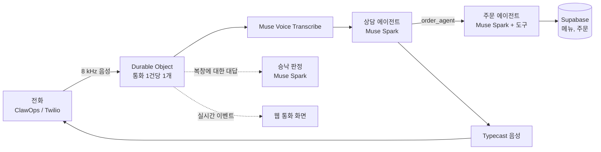

# 콜오더 (CallOrder)

[English](README.md) | **한국어**

**전화 한 통으로 주문하세요.** 콜오더는 배달앱이 어려운 어르신을 위한 AI 음성 주문 서비스입니다. 앱도, 화면도, 결제 단계도 없이 번호로 전화해서 원하는 것을 말하면 됩니다.

▶ **시연 영상:** https://youtu.be/lLVrAXMHL50

Meta Global AI Developer Hackathon 출품작입니다(Indie Developer Track, Build for Your World).

## 직접 걸어 보기

| | |
|---|---|
| 🇰🇷 한국 번호 | **070-5276-7404** |
| 🇺🇸 미국 번호 | **+1 515-349-6768** |
| 웹 | https://callorder-web.pages.dev |

두 번호 모두 한국어와 영어를 알아듣습니다. 주문은 시연용 주소로 들어갑니다. 웹 통화 화면과 개발자 뷰는 접속 코드와 심사용 계정이 필요하며, 해커톤 제출 내용에 적어 두었습니다.

## 통화는 이렇게 진행됩니다

1. **첫 통화:** 상담원이 배달 주소를 묻고 저장합니다. 시연 중에는 배달 주소가 시연용 주소로 정해지며, 이를 손님에게 안내합니다.
2. **주문:** 메뉴를 말하면("떡볶이 2인분 주세요") 가게를 찾고, 맵기 같은 필수 옵션을 묻고, 실제 메뉴와 가격으로 금액을 계산합니다.
3. **복창:** 주문 내용을 전부 다시 읽어 줍니다. **손님이 승낙해야만 주문됩니다.** 승낙인지는 별도 모델이 한국어든 영어든 판단하므로 "그래, 그렇게 보내 줘"는 주문되고 "네, 근데 콜라 하나 더요"는 주문되지 않습니다.
4. **다시 걸기:** 주문이 배달 중일 때 다시 걸면 남은 시간을 먼저 알려 줍니다.

## 화면

| 화면 | 경로 | 내용 |
|---|---|---|
| 통화 화면 | `/sim` | 브라우저 전화 시뮬레이터, 또는 실제 통화 실시간 보기. 거는 휴대폰 번호를 넣으면(최대 3개) 통화마다 칸이 올라오며 대화가 실시간으로 뜹니다 |
| 가게 주문 화면 | `/merchant` | 전화 주문의 메뉴, 배달지, 금액. 한 번에 수락하거나 거절합니다. 손님 번호는 끝 네 자리만 보입니다 |
| 개발자 뷰 | `/admin` | 통화마다 결과, 통화 시간, 첫 응답 시간, 비용(통화당 약 4센트), 시각이 붙은 대화 기록, 에이전트의 도구 호출, 녹음 |
| 가게 목록 | `/stores` | 지도 위 가게와 메뉴 |

## 동작 방식



- **Muse Spark 1.3**이 도구 호출을 쓰는 에이전트 둘로 통화를 진행합니다. 상담 에이전트는 짧은 구어체로 손님과 이야기하고, 주문 에이전트는 가게·메뉴·장바구니·금액·복창·주문 실행을 도구(`find_menu`, `cart_add`, `request_confirmation`, `place_order`)로 처리하며 Supabase의 실제 데이터만 씁니다.
- **복창에 대한 대답은 세 번째 Muse Spark 호출이 판정합니다.** 복창 문구와 대답만 보고 통화의 나머지는 보지 않습니다. 그 뒤에도 `place_order`는 코드가 발급한 확인 토큰이 있어야 실행됩니다.
- **Muse Voice Transcribe 1.0**이 가게와 메뉴 이름을 키워드로 받아 전화 음성을 실시간으로 받아씁니다. STT와 LLM이 Meta API 키 하나를 함께 씁니다.
- 통화마다 **Cloudflare Durable Object** 하나가 전화선, STT, 에이전트, TTS 사이로 음성을 흘려보내고, 통화를 녹음하고, 웹 통화 화면에 실시간 이벤트를 보냅니다.

## 저장소 구조

```
apps/web            통화 화면, 가게 주문 화면, 개발자 뷰 (React, shadcn/ui, Cloudflare Pages)
apps/voice-worker   통화 1건당 Durable Object 1개 (Cloudflare Workers)
packages/agents     프롬프트, 도구, 에이전트 루프, 주문 확인 게이트
packages/adapters   MerchantAdapter와 Supabase 저장소
packages/audio      μ-law, 리샘플러
supabase            마이그레이션과 데모 데이터
eval                가짜 Meta·TTS·Supabase로 돌리는 종단 간 테스트
```

## 개발

Node 26과 pnpm 12가 필요합니다.

```sh
pnpm install
pnpm test        # 단위 테스트
pnpm e2e         # 가짜 Meta·TTS·Supabase로 통화 전 과정을 실행 (키 불필요)
pnpm typecheck

cp apps/web/.env.example apps/web/.env.local
pnpm dev:voice   # apps/voice-worker/.dev.vars에 아래 비밀값과 ALLOWED_ORIGINS=http://localhost:5173 필요
pnpm dev:web     # http://localhost:5173/sim
```

### Worker 비밀값

`apps/voice-worker`에서 `npx wrangler secret put <이름>`으로 등록합니다. 스테이징은 `--env staging`을 붙입니다.

| 이름 | 내용 |
|---|---|
| `META_API_KEY` | Meta Model API 키. LLM과 STT 모두 이 키를 씁니다 |
| `TTS_API_KEY` | Typecast API 키 |
| `PHONE_WEBHOOK_TOKEN` | ClawOps Webhook이 `X-Callorder-Token` 헤더로 보내는 공유 비밀값 |
| `TWILIO_AUTH_TOKEN` | Twilio Webhook 서명 검증 |
| `SUPABASE_SERVICE_ROLE_KEY` | Supabase 서비스 역할 키 |
| `SIM_ACCESS_CODE` | 웹 통화 화면 접속 코드 |

TTS는 Typecast(`ssfm-v31`)입니다. `wrangler.jsonc`의 `TTS_PROVIDER`를 `none`으로 바꾸면 음성 없이 글자로만 진행되고, Soniox 연결도 코드에 남아 있습니다.

### 배포

`main`에 푸시하면 Cloudflare가 Pages(`callorder-web`)와 Worker(`callorder-voice`)를 빌드해 배포합니다. Supabase 마이그레이션은 배포에 포함되지 않으니 직접 적용합니다.

### 전화번호

- **한국 번호(ClawOps):** 착신을 Webhook `https://callorder-voice.kwdg1213.workers.dev/phone/voice`(POST)로 두고 `X-Callorder-Token` 헤더를 넣습니다.
- **미국 번호(Twilio):** "A call comes in"을 Webhook `https://callorder-voice.kwdg1213.workers.dev/twilio/voice`(HTTP POST)로 둡니다.

처음 거는 번호는 `customers`에 등록됩니다(이름 `고객`, 시연용 주소 행복동 12번지). 주소 질문에 손님이 말한 내용은 `stated_address`에 저장됩니다. 발신번호가 표시되지 않는 전화는 고객 없이 연결되며 주문할 수 없습니다. 대화 기록과 녹음은 관리자만 볼 수 있고, 녹음은 30일 뒤 지워집니다.
