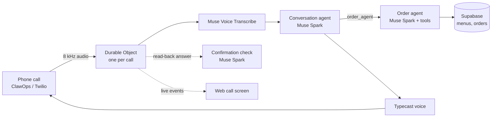

# CallOrder

**English** | [한국어](README.ko.md)

**Order food with one phone call.** CallOrder is an AI voice ordering service for seniors who find delivery apps hard to use. No app, no screen, no checkout: call a number and say what you want.

▶ **Demo video:** https://youtu.be/lLVrAXMHL50

Built for the Meta Global AI Developer Hackathon (Indie Developer Track, Build for Your World).

## Try it

| | |
|---|---|
| 🇰🇷 Korean number | **070-5276-7404** |
| 🇺🇸 US number | **+1 515-349-6768** |
| Web | https://callorder-web.pages.dev |

Both numbers understand Korean and English. Orders go to a demo address. The web call screen and the developer view need an access code and a reviewer login, which are in the hackathon submission.

## What a call looks like

1. **First call:** the agent asks for your delivery address and keeps it. During the demo, delivery is fixed to a demo address and the caller is told so.
2. **Ordering:** say a dish ("two tteokbokki, please"). The agent finds the store, asks for required options such as spice level, and works out the total from real menus and prices.
3. **Read-back:** the agent reads the whole order back. **Nothing is ordered until the caller agrees.** A separate model judges any way of saying yes, in Korean or English, so "sure, send it like that" works and "yes, but add a coke" does not.
4. **Calling back:** while an order is on its way, the call opens with how many minutes are left.

## Screens

| Screen | Path | What you see |
|---|---|---|
| Call screen | `/sim` | A browser phone simulator, or live real calls: enter the phone numbers you call from (up to 3) and each call rises into its own panel with the conversation as it happens |
| Store board | `/merchant` | Every phone order with items, address and total. Accept or decline in one tap. Callers show only by their last four digits |
| Developer view | `/admin` | Every call with result, length, first-reply time and cost (about 4 cents a call), the transcript with timings, the agents' tool calls, and the recording |
| Store directory | `/stores` | Stores on a map with their menus |

## How it works



- **Muse Spark 1.3** runs the call as two agents with function calling. The conversation agent talks with the caller in short spoken sentences. The order agent handles stores, menus, cart, pricing, read-back and placing the order with tools (`find_menu`, `cart_add`, `request_confirmation`, `place_order`), using only real data from Supabase.
- **A third Muse Spark call judges the answer to the read-back.** It sees only the recap and the reply, never the rest of the call. `place_order` still needs a confirmation token issued in code after that yes.
- **Muse Voice Transcribe 1.0** transcribes phone audio in real time, with store and menu names as keywords. STT and the LLM share one Meta API key.
- Each call runs in its own **Cloudflare Durable Object**, which streams audio between the phone line, STT, the agents and TTS, records the call, and reports live events to the web call screen.

## Repository

```
apps/web            Call screen, store board, developer view (React, shadcn/ui, Cloudflare Pages)
apps/voice-worker   One Durable Object per call (Cloudflare Workers)
packages/agents     Prompts, tools, agent loop, confirmation gate
packages/adapters   MerchantAdapter and Supabase repositories
packages/audio      μ-law and resampling
supabase            Migrations and demo data
eval                End-to-end test with fake Meta, TTS and Supabase
```

## Development

Requires Node 26 and pnpm 12.

```sh
pnpm install
pnpm test        # unit tests
pnpm e2e         # a whole call against fake Meta, TTS and Supabase (no keys needed)
pnpm typecheck

cp apps/web/.env.example apps/web/.env.local
pnpm dev:voice   # needs apps/voice-worker/.dev.vars with the secrets below and ALLOWED_ORIGINS=http://localhost:5173
pnpm dev:web     # http://localhost:5173/sim
```

### Worker secrets

Set them in `apps/voice-worker` with `npx wrangler secret put <NAME>` (add `--env staging` for staging).

| Name | Purpose |
|---|---|
| `META_API_KEY` | Meta Model API key, used for both the LLM and STT |
| `TTS_API_KEY` | Typecast API key |
| `PHONE_WEBHOOK_TOKEN` | Shared secret the ClawOps webhook sends in the `X-Callorder-Token` header |
| `TWILIO_AUTH_TOKEN` | Verifies Twilio webhook signatures |
| `SUPABASE_SERVICE_ROLE_KEY` | Supabase service role key |
| `SIM_ACCESS_CODE` | Access code for the web call screen |

TTS is Typecast (`ssfm-v31`). Setting `TTS_PROVIDER` in `wrangler.jsonc` to `none` runs calls in text only; a Soniox connection also remains in the code.

### Deployment

Pushing to `main` makes Cloudflare build and deploy Pages (`callorder-web`) and the Worker (`callorder-voice`). Supabase migrations are not part of the deploy; apply them yourself.

### Phone numbers

- **Korean number (ClawOps):** point incoming calls to the webhook `https://callorder-voice.kwdg1213.workers.dev/phone/voice` (POST) with the `X-Callorder-Token` header.
- **US number (Twilio):** set "A call comes in" to the webhook `https://callorder-voice.kwdg1213.workers.dev/twilio/voice` (HTTP POST).

A number calling for the first time is registered in `customers` (name `고객`, demo address 12 Haengbok-dong). What the caller says on the address question is kept in `stated_address`. Calls with a hidden caller ID connect without a customer and cannot order. Transcripts and recordings are visible only to admins, and recordings are deleted after 30 days.
